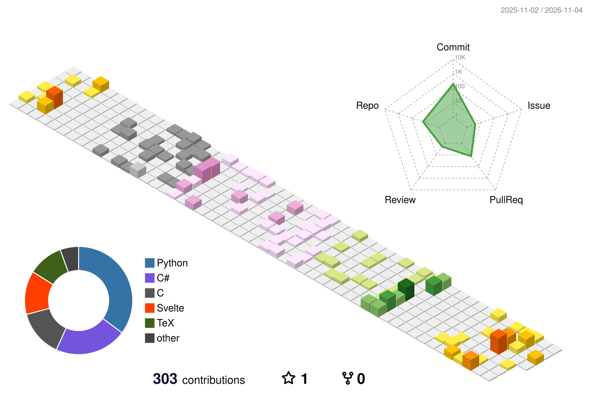

# viktorz05

<!--
**viktorz05/viktorz05** is a ✨ _special_ ✨ repository because its `README.md` (this file) appears on your GitHub profile.

Here are some ideas to get you started:

- 🔭 I’m currently working on ...
- 🌱 I’m currently learning ...
- 👯 I’m looking to collaborate on ...
- 🤔 I’m looking for help with ...
- 💬 Ask me about ...
- 📫 How to reach me: ...
- 😄 Pronouns: ...
- ⚡ Fun fact: ...
-->
Hi, I'm Viktor, I'm currently a **Research Assistant** at Simon Fraser University working on validating biomechanical simulation :D.

## About me
- I like videogames
- I have an interest in computer graphics 
- I did the Vancouver Sun Run 10K
- I'm from Mexico  
- Pronouns: he/him
- Fun fact: I went skydiving for my 10th birthday
---

